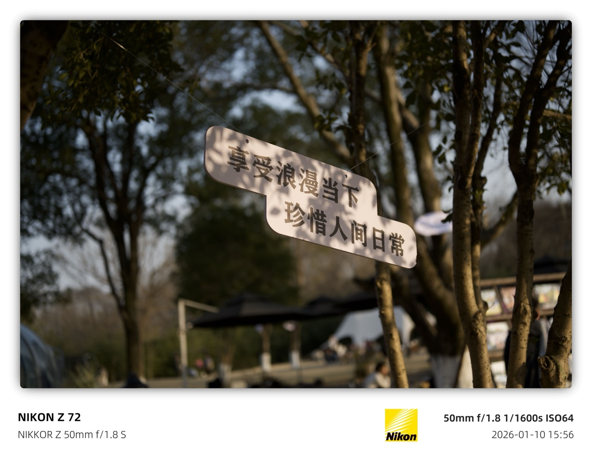
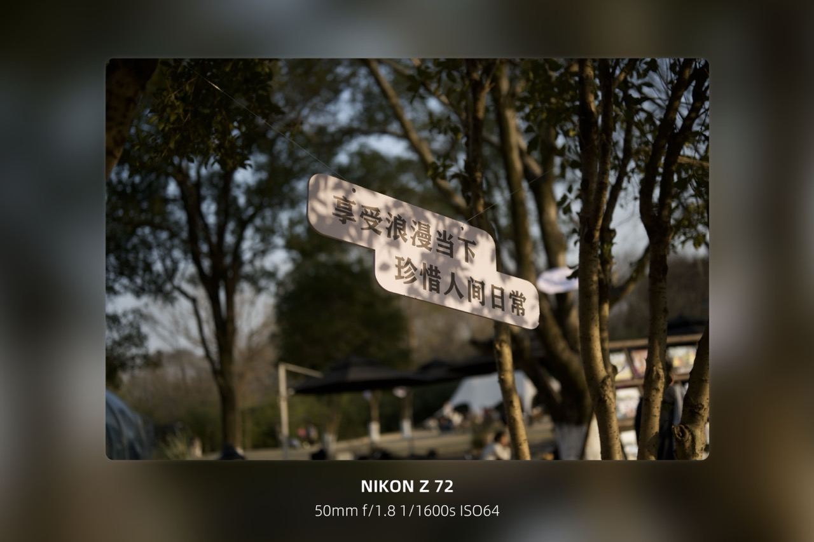
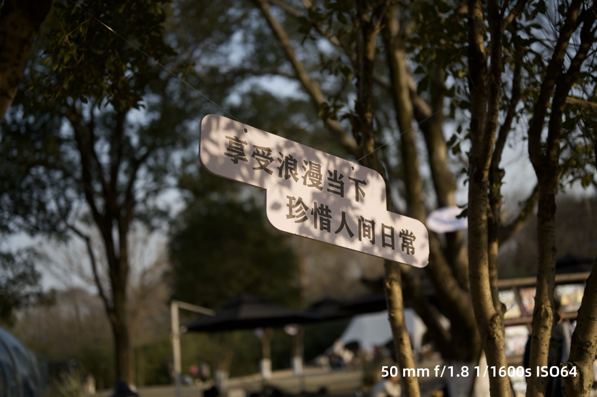
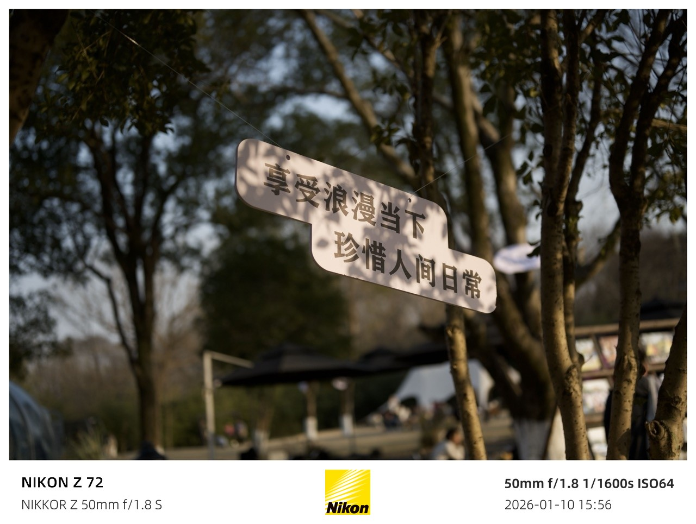

# semi-utils

> [](https://github.com/leslievan/semi-utils)
> [](https://github.com/leslievan/semit-utils/releases)
> [](https://github.com/leslievan/semi-utils/releases)
> [](https://github.com/leslievan/semi-utils/blob/master/LICENSE)
> 
>
> **这是一个用于给照片批量添加水印、处理照片像素比、图像色彩和质量的工具。**

当前仅支持 Windows，运行源码需 Python 3.13 或更高版本。照片元数据读取使用项目内的 ExifTool，支持 `exiftool/exiftool.exe` 和官网下载包中的 `exiftool/exiftool(-k).exe`，请将 `exiftool_files` 与程序保留在同一目录。

## 桌面窗口

ExifFrame 提供独立桌面操作窗口，无需启动浏览器，也不依赖在线界面资源。

1. 设置输入、输出目录，在文件树中浏览并勾选照片，也可以添加或拖入照片
2. 选择模板，按需新建、另存副本或编辑 JSON/Jinja 源码
3. 预览水印并切换原图对照，选择按模板原样处理或使用快捷样式参数
4. 设置质量和覆盖选项，批量导出后在输出文件树中查看结果

快捷调整的“水印缩放”以 100% 保留模板默认比例；无底栏模板按比例调整文字。底部留白可选择“自动”，或拖动滑块按照片高度的 6%–30% 固定高度；缩放过大时内容可能超出固定底栏。只有实际选择底色或文字颜色后才覆盖模板颜色，滑块移回最左侧可恢复自动留白。

### 照片信息与语言

在“照片信息”菜单或使用 `Ctrl+I` 打开编辑器，可编辑相机、镜头、曝光、拍摄时间、版权及 GPS 等 27 项信息。修改默认只用于当前会话的水印预览和导出，保留原照片。需要把信息写入文件时，可保存修改副本，或从 RAW/JPG 参考照片迁移信息到目标照片副本。

通过“语言”菜单可即时切换简体中文与英文，照片队列、勾选范围和未保存内容会保留，语言偏好保存在本机的 `config/ui.json`。

新建模板可从内置样式、当前模板或空白边框开始，选择文字区域并添加独立字段，分别调整顺序、分隔符和前后文字，再按需进入高级源码编辑。

新建页面默认使用项目自带的无水印示例照片，没有导入照片也能直接预览；右侧编辑水印内容，修改后自动更新画面。样式在顶部通过纯文字下拉框选择，不显示小缩略图。空画面只保留中间的“选择照片”入口，已有画面可通过照片右键菜单换图。模板名称和高级源码位于顶部，创建操作固定在底部，切换样式会保留各自的组合草稿。

侧栏模板样图连同外框按原图比例显示，缩放时保留完整画面。新建页在小窗口下优先保留照片空间，参数列表使用预览照片的实际数值。示例照片复用原项目样图中的干净照片区域，不加入照片队列，也不会混入用户的临时 EXIF 修改；来源和制作过程见 `scripts/build_preview_sample.py`。

### 自由组合底部信息

点击右侧“水印模板”里的“组合底部信息…”（`Ctrl+Shift+E`）：

1. 选择左上、左下、右上或右下；无边框样式会列出自身的文字区域
2. 双击独立字段添加内容，焦距、光圈、快门、ISO 可以分开组合，也可添加自定义文字
3. 拖动或使用上移、下移调整顺序，分别设置每个区域的分隔符，以及字段前后的文字
4. 实时查看照片效果，也可点击“更新预览”；使用“保存模板”或“另存为”保留组合

水印编辑窗口左侧直接显示照片结果，右侧集中调整内容；修改有效组合后会延时自动更新，可切换适应、原始预览比例及水印细节。窗口支持最小化和最大化，也可收起编辑窗口回主窗口查看，未保存组合会保留。字段库通过搜索添加，格式选项按需展开，减少常驻面板占用。

新建、组合和高级源码编辑都可在同一窗口查看实际照片效果。字段列表按内容显示两到五行，前后缀输入框保持紧凑。预览使用后台任务，快速修改只更新最新有效结果；无效修改保留上次画面，保存模板后才写入文件。

例如可将左上设为 `ISO160 | Alice | 1/250s`，右下设为日期与版权。缺失信息可选择隐藏或显示破折号。需要改 ISO、快门等实际数值时，直接使用组合面板中的“修改照片信息…”；原照片保持不变。

“地理位置”将经纬度作为一个字段，显示为 `26°9'12"N 119°17'8"E`。支持照片中的十进制度与度分秒数据，保留南北纬、东西经方向，并自动处理秒数进位。缺少任一坐标时不显示半组位置。旧模板的独立经纬度项仍可读取，在同一区域同时存在时可点击“合并已有经纬度”。

海拔字段以 `3555m` 显示，海平面下使用负号（如 `-3555m`），保留有效小数，缺失时按所选缺失值规则处理。

水印日期默认使用 `2026.11.04` 格式，仅显示年月日；需要时可单独添加“拍摄时间”或选择“日期与时间”。照片文件中的 EXIF 时间仍按原格式保留。

自定义文字支持 `ℤ`、`ℝ`、`ℂ`、`𝕫` 等符号。水印字体缺少 `ℤ` 时，直接沿用该字体的 Z 轮廓生成双线字形，保持相同字高、字宽、粗细、基线和收笔风格。其他缺字自动使用系统符号字体，并按原字体库匹配笔画粗细。输入框、字段列表、预览和导出均保留原字符，已有文字继续使用原字体。

常用工具栏按“添加照片 → 修改照片信息 → 组合水印 → 导出照片”排列。“保存设置”用于目录和导出选项，“保存模板”用于水印组合，避免保存对象混淆。界面采用中性灰黑分层、小圆角和灰色边框，焦点、选中、禁用及悬停状态均不使用蓝色强调；功能图标保留原有颜色。文件区保持紧凑，设置区和编辑窗口留出清晰的页边距与滚动间隔。

“高级源码”仍保留在模板区、组合窗口和模板菜单，快捷键为 `Ctrl+E`。两种编辑方式切换时可携带未保存草稿；无法自动识别的高级表达式会保留，不会被可视化面板静默删掉。新建模板向导使用同样的组合面板，不再将拍摄参数绑成固定的一组。

输入目录内的照片按相对目录结构导出，PNG 保留为 PNG，其他支持格式导出为 JPEG。同名输出默认跳过，启用覆盖后仅替换独立输出目录中的文件。单独添加的照片使用 `_watermarked` 后缀，默认自动编号。程序始终保护原照片。“按模板原样处理”的预览从完整渲染结果缩略，快捷调整模式使用快速预览。没有 ExifTool 时会读取照片自带的 EXIF 信息。

源码预览使用当前勾选的照片队列，并随会话照片信息更新；示例照片始终保持独立。启用覆盖时，已导入队列中未勾选的原片也受到保护，模板的 `files` 仍只包含勾选照片。

批量导出在已核验的内置模板、内存充足且输出路径不冲突时最多同时处理两张照片；自定义或修改过的模板及其他情况按顺序处理。取消操作会等待已经开始的照片完成，并保留成功、失败和跳过统计。参数文字预览复用有界缓存，照片数据仍按当前预览单独传入。功能对照、验证范围和实测条件见 [网页功能对照与性能验证](docs/compatibility-and-performance.md)。

在项目目录安装依赖后启动：

```powershell
python -m pip install -r requirements.txt
python main.py
```

使用本机已配置的 Conda 环境：

```powershell
& 'D:\miniconda3\envs\Python3.13\python.exe' -m pip install -r requirements.txt
& 'D:\miniconda3\envs\Python3.13\python.exe' main.py
```

`main.py` 仅负责启动桌面窗口；需要原版浏览器界面时运行 `python web_server.py`。两个入口共用水印处理器和 ExifTool 读取逻辑。

输入输出目录、模板、JPEG 质量、色度采样和覆盖开关以 `config/config.ini` 为准，桌面旧缓存不会覆盖这些共用配置。桌面独有的样式参数保存在 `config/desktop.json`。选择“按模板原样处理”后，保留模板的文字、颜色和明确指定的尺寸，并沿用原版保存方式。未指定尺寸的标准底栏按旧版整体排版后缩放到照片宽度，文字、标识和间距同步变化；横图与竖图使用各自的原版比例。模板明确启用的居中栏适配继续生效。

### 验证与打包

Windows x64 构建使用 Python 3.13 和 PyInstaller 6.20.0。请先准备包含程序与 `exiftool_files` 的 `exiftool` 目录；构建依赖的固定版本见 `build_support/requirements-windows.txt`。在已安装这些依赖的构建环境中执行：

```powershell
python build_support/build_windows.py
```

结果为 `dist/single/ExifFrame.exe`，可单独分发，内含模板、字体、标识、示例图片和 ExifTool。首次运行会在 `%LOCALAPPDATA%\ExifFrame` 下创建用户配置；后续更改的配置与模板保存在该位置。如果 EXE 同目录已有旧版 `config`，首次运行会复制旧配置，旧配置中的相对输入和输出路径仍指向原程序目录，原文件不会改动。启动时单文件程序需要解压内置资源，启动时间可能比目录版长。

首次构建时脚本会从 PyPI 下载固定版本的 NumPy wheel 并校验 SHA256，之后使用 `build/wheels` 中的缓存，可离线重复构建。wheel 仅在 `build` 下的临时目录安装和使用，不会改动当前 Python 环境。若要创建资源外置的目录版，可运行 `python build_support/build_windows.py --onedir`；输出目录会显示在命令结果中，发布时需保留其中所有文件。每次目录版构建都使用新的目录，不会覆盖旧版本的配置和照片。GitHub Windows 发布流程使用固定构建依赖并发布单文件 EXE。

“品牌标识居中”显示居中标识及两侧完整 EXIF，“仅标识居中”保留简洁的单标识版式。

模板样图采用缩放解码，照片缩略图、标识、编译模板与字体均有有界缓存；文件修改后自动更新，不使用旧缓存替代新的照片内容。

`test/` 和 `tests/` 作为本地验证目录忽略，不随仓库提交。保留本地测试文件时可运行 `python -m unittest discover -s tests -v`。

如果您觉得程序对您有所帮助的话，可以点击 [Sponsor](https:/su/cdn.lsvm.xyz/wechat.jpg) 按钮请作者喝杯咖啡，谢谢！


## 开发文档

**[Wiki](../../wiki)**

## 效果展示

| 模板                                     | 描述                                      | 效果                                      |
|----------------------------------------|-----------------------------------------|-----------------------------------------|
| [standard1](./static/standard1.json)   | 经典 EXIF 水印，包含相机型号、镜头、焦距、光圈、快门、ISO、拍摄时间和相机品牌 Logo |    |
| [standard2](./static/standard2.json)   | 在 standard1 基础上添加圆角、阴影效果和留白，适合社交媒体分享 |    |
| [nikon_blur](./static/nikon_blur.json) | 尼康风格水印，相机型号中的红色「Z」字高亮，配合模糊背景效果 |  |
| [blur](./static/blur.json)             | 简洁风格，相机型号+参数垂直居中展示，配合模糊背景效果 |              |
| [normal1](./static/normal1.json)       | 极简风格，右下角显示拍摄参数，低调不抢眼 |        |
| [normal2](./static/normal2.json)       | 文件夹名称+拍摄时间，橙色文字，简洁实用 |        |
| [center_logo](./static/center_logo.json) | 中心 Logo 水印，可自定义四周文字内容 |        |


## 许可证

Semi-Utils 的发布基于 [Apache License 2.0](LICENSE).

### exiftool

Semi-Utils 引用了 [exiftool](https://exiftool.org/)，其发布基于 [GPL v1 + Artistic License 2.0](https://exiftool.org/#license)。


## 关于

[](https://starchart.cc/leslievan/semi-utils)
