# ExifFrame

ExifFrame 是一款 Windows 照片水印工具，支持批量为 JPEG、PNG 和 HEIC 照片添加拍摄信息水印，也可以组合自定义文字和编辑模板。项目基于 [leslievan 的 semi-utils](https://github.com/leslievan/semi-utils) 开发，增加了桌面窗口、可视化编辑、照片信息编辑和中英文切换

## 开始使用

### 发布版

下载 Release 中的 `ExifFrame.exe` 后直接运行，无需安装 Python 或另行准备 ExifTool。首次运行会在 EXE 旁创建 `config` 文件夹，保存设置和自建模板；更新程序时保留这个文件夹即可沿用配置，程序目录需要有写入权限

### 源码运行

开发和打包使用 Windows x64 与 Python 3.13。从 [ExifTool 官网](https://exiftool.org/) 下载 Windows 版，将程序和支持文件一起放入项目目录

```text
exiftool/
├── exiftool.exe
└── exiftool_files/
```

程序名也可以保留为 `exiftool(-k).exe`，但旁边的 `exiftool_files` 文件夹不能省略。准备好后，在项目目录安装依赖并启动

```powershell
python -m pip install -r requirements.txt
python main.py
```

缺少 ExifTool 时，启动会提示补全目录，水印编辑和导出仍可使用，拍摄信息会尝试从照片自带的 EXIF 读取；检查器仍可修改水印显示的拍摄参数。高级信息编辑器、保存信息副本和迁移信息需要完整的 ExifTool。旧版浏览器界面可通过 `python web_server.py` 启动

## 添加水印

1. 添加照片或选择输入目录，也可以将照片拖入窗口
2. 新加入的照片默认不勾选，第一张会高亮并显示预览。点击底部胶片带的缩略图即可切图。勾选角标决定哪些照片一起导出，也可以全选、取消全选或反选
3. 在右侧「预设库」选择模板。「画框定制」调整边框与背景。直接点照片上的水印文字或 Logo，会进入对应槽位的字体、颜色或标识设置
4. 选择输出目录，设置 JPEG 质量和覆盖选项。没有勾选时点「导出当前照片」，勾选后按钮会显示批量导出的张数

「仅应用到当前照片」会固定这一张的模板和样式。要让一组照片共用版式，勾选它们并点「同步样式到已选」，每张照片仍使用自己的拍摄信息。Logo 默认按相机品牌识别，也可指定品牌或图片。要让新加入的照片沿用某个模板，在预设页点「设为默认」，点「保存设置」可在下次启动时继续使用

画框可以在「画框定制 → 边框与背景」里调整。毛玻璃提供亮度、暗角和模糊强度，内嵌角标可选位置和不透明度。打开色卡栏可在底部显示照片的五个主色。拍摄信息、单字强调色和品牌 Logo 沿用同一套编辑方式

拖动参数滑条可以边调边看，也可以点击右侧数值直接输入，按 Enter 确认、Esc 还原。↑ / ↓ 微调，按住 Shift 可一次调整十步。双击参数名或滑块手柄可恢复默认值。数值旁标有百分比、像素或角度等单位。按 Ctrl+Z 撤销，Ctrl+Y 重做。在右侧面板滚动鼠标滚轮只会翻页

查看细节时，把鼠标放在照片上滚动，可在 10% 到 400% 之间缩放。按住左键拖动画面，双击在适应窗口和 1:1 之间切换，也可以点击画布底部的「适应」或「1:1」。同一栏还显示原图尺寸和预计输出尺寸。点击预览画布后按住空格可对照原图，松开即回到水印预览。画布超过 100% 时会在后台加载原分辨率细节，浏览倍率不会改变导出尺寸

### 画框定制

在「画框定制」选择自由外扩或固定画幅。四边可单独调节或锁定比例。固定画幅会先保留四边留白，再按水平和垂直偏移放置完整照片。背景可用纯色、渐变、原图主色、模糊照片或自选图片，还可叠加纸纹或颗粒。照片的圆角、描边和投影可单独调整

装饰从上到下依次绘制，列表中靠后的项目盖在前面的项目上。可组合双线框、胶片齿孔、3～8 色的色卡、取景标记和透明 PNG 边框。九宫格模式分别设置贴图的四条切边，让四角保持比例

在「预设库」另存当前效果，即可在「我的模板」中找到。右键卡片可应用、复制或导出；自己的模板还可以重命名、用当前调整覆盖或删除。

默认导出的 **PNG 模板卡片** 可以直接看效果，也包含模板、样式和引用的边框与 Logo。把原始 PNG 发给对方，在 ExifFrame 中导入即可。聊天软件重新压缩图片时可能移除模板数据，分享时可选择发送原文件。需要手工编辑配置可导出 JSON，引用的外部图片需一并保留。旧版 ZIP 和 `.efstyle` 仍可导入。[下载 4:5 吸色双线框 PNG 卡片](docs/examples/吸色双线框.png) · [旧版样式包](docs/examples/吸色双线框.efstyle)


### 编辑模板

在「文字与 Logo」选中一个文字槽位，即可单独设置字体、字号和颜色。在「内容模板」中添加、删除或移动字段，调整分隔符；要一起放大或缩小水印，切到「全局比例」

要给某个字换颜色或字体，展开该槽位的「单字染色」，点击照片实际显示的字符。按住 Shift 可连续选择，拖动可框选多个字。若要让不同长度的相机型号都突出同一段文字，例如只让型号里的 `Z` 变红，可以把选中的 `Z` 转成匹配规则，再点「同步样式到已选」

点「新建」可从空白预设开始，也可以选好样式后点「另存为预设」，没有导入照片时使用项目示例预览，示例不会加入导出队列。需要修改 JSON/Jinja 时打开高级源码，修改会自动更新预览，保存模板后保留；切换编辑方式时，未保存的草稿和已有表达式会保留

- 日期默认显示为 `2026.11.04`，拍摄时间和日期与时间可以单独添加
- 地理位置合并经纬度，以度分秒显示，例如 `26°9'12"N 119°17'8"E`，缺少任一坐标时隐藏整项
- 海拔显示为 `3555m`，海平面以下为 `-3555m`，有小数时保留有效数值
- 自定义文字支持 `ℤ`、`ℝ`、`ℂ`、`𝕫` 等符号，预览和导出保留原字符

在「文字与 Logo → 全局比例 → 排版高级选项」里可以选择尼康 ℤ 的显示方式。默认几何符号随字体粗细调整双斜笔，也可选普通 `Z` 或系统字体。可随当前样式另存为预设。三种方式都可单独给 ℤ 上色，保留照片里的原始字符。[查看五种字重的实际效果](docs/nikon-z.png)

## 照片信息与导出

在「EXIF 信息」里可直接修改当前照片的相机型号、曝光参数、拍摄时间、地点名或自定义文字。要批量修改，在底部胶片带勾选照片，在右侧勾选要同步的字段，再点「批量覆写已勾选 EXIF」。例如只勾地点名时，各张原有的相机型号和备注都会保留。这些修改只用于本次水印预览和导出。版权、GPS 等字段收在「更多字段」。保存照片信息副本或从参考照片迁移 EXIF 时，打开「无损副本与高级文件操作」

- 输入目录内的照片可保留相对目录结构，PNG 仍导出为 PNG，其他支持格式导出为 JPEG；目录外单独添加的照片使用 `_watermarked` 后缀，同名时默认自动编号
- 已有输出默认跳过，启用覆盖后只替换允许覆盖的文件；已导入原片始终受到保护，包括没有勾选的照片
- 取消导出会保留已完成文件，并显示成功、失败和跳过数量

## 设置与快捷键

工具栏可切换中英文和明暗主题。「查看」菜单提供胶片带开关和项目作者信息。切换语言会保留照片队列、勾选状态和未保存内容；各版本默认使用程序目录下的 `config` 文件夹

| 文件 | 保存内容 |
| --- | --- |
| `config/config.ini` | 输入输出目录、模板和导出选项 |
| `config/desktop.json` | 桌面样式设置 |
| `config/ui.json` | 语言偏好 |

旧版用户首次启动新版单文件程序时，会尝试迁移 `%LOCALAPPDATA%\ExifFrame` 中的配置，程序旁已有配置优先保留，旧目录文件不会被删除

| 操作 | 快捷键 |
| --- | --- |
| 编辑照片信息 | `Ctrl+I` |
| 组合底部信息 | `Ctrl+Shift+E` |
| 编辑高级源码 | `Ctrl+E` |

## 构建与发布

### 本地打包

补全项目的 `exiftool` 目录后，在 Windows x64 的 Python 3.13 环境中执行

```powershell
python -m pip install -r build_support/requirements-windows.txt
python build_support/build_windows.py
```

生成的程序位于 `build/ExifFrame.exe`，已包含 ExifTool、模板、字体和标识，分发时只需要这个 EXE。构建直接使用本地 ExifTool，NumPy 下载包保存在 `build/download`，存在时复用，不做额外的哈希校验或来源核验

临时依赖和分析文件位于项目外的系统临时目录，结束后自动清理，下载缓存、程序和用户配置保留。构建会限制处理器与内存占用；`--numpy-wheel` 可指定本地 NumPy 包，`--onedir` 可生成需要整目录分发的目录版

### GitHub Release

在 Actions 中手动运行 Windows 发布工作流并填写版本标签，例如 `v2.1.5`，发布新版本时建议选择默认分支，也可以推送 `v` 开头的标签触发。已有标签会构建对应版本，新标签在构建成功后创建；随后自动发布 Release，附上 `ExifFrame.exe`，并生成包含版本、平台和运行方式的简短说明

云端使用 Windows 2025 和 Python 3.13 x64，分别缓存 Python 依赖、NumPy 和 ExifTool。ExifTool 缓存缺失时，从[官方发布目录](https://sourceforge.net/projects/exiftool/files/)下载固定的 13.60 Windows 64 位包；这一步只在云端执行，本地打包仍使用已有文件

重复运行同一版本时，会保留已有发布说明和程序附件，只补全缺失内容。默认分支运行也方便后续标签构建复用缓存，缓存作用域见[GitHub 说明](https://docs.github.com/en/actions/reference/workflows-and-actions/dependency-caching#restrictions-for-accessing-a-cache)；其他分支的工作流文件与默认分支不同时，自动发布可能受 [GitHub 权限规则](https://docs.github.com/en/rest/releases/releases#create-a-release)限制

## 模板示例

| [极简无框角标](config/templates/极简无框角标.json) | [拍立得经典宽底](config/templates/拍立得经典宽底.json) | [毛玻璃悬浮卡片](config/templates/毛玻璃悬浮卡片.json) | [美术馆装裱画框](config/templates/美术馆装裱画框.json) |
| --- | --- | --- | --- |
| 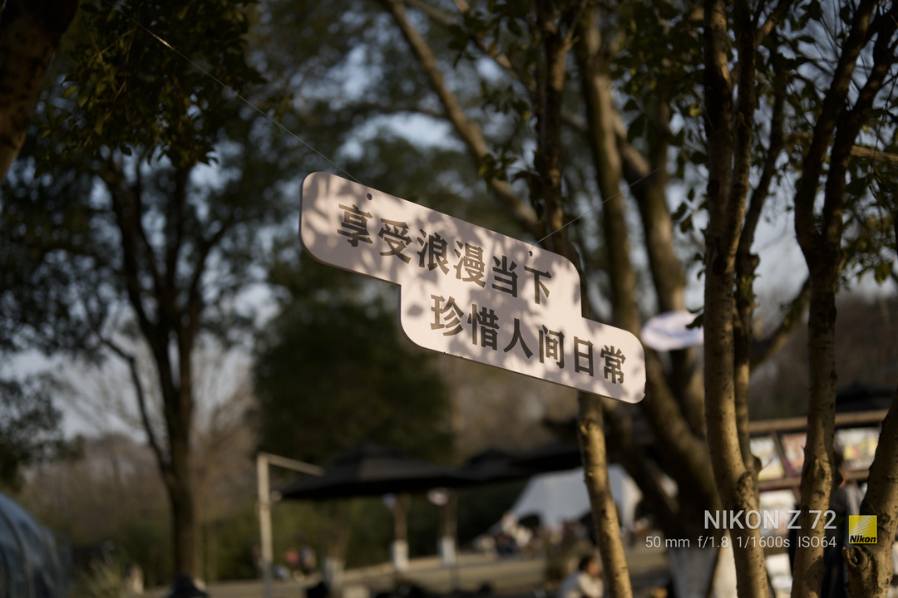 | 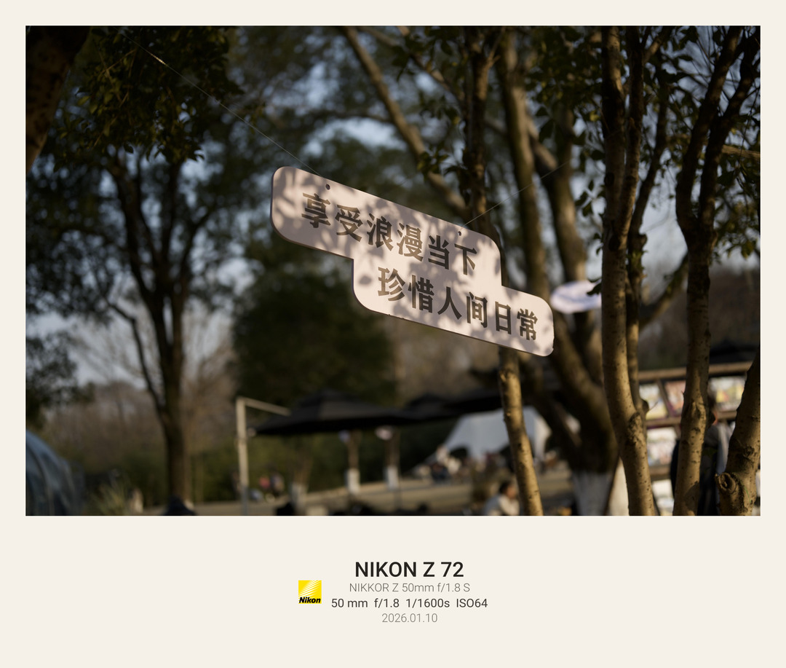 | 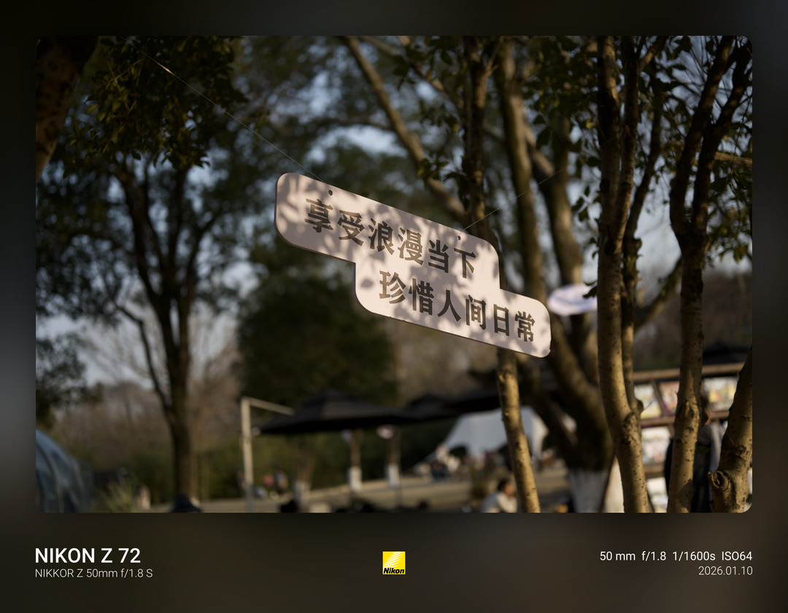 | 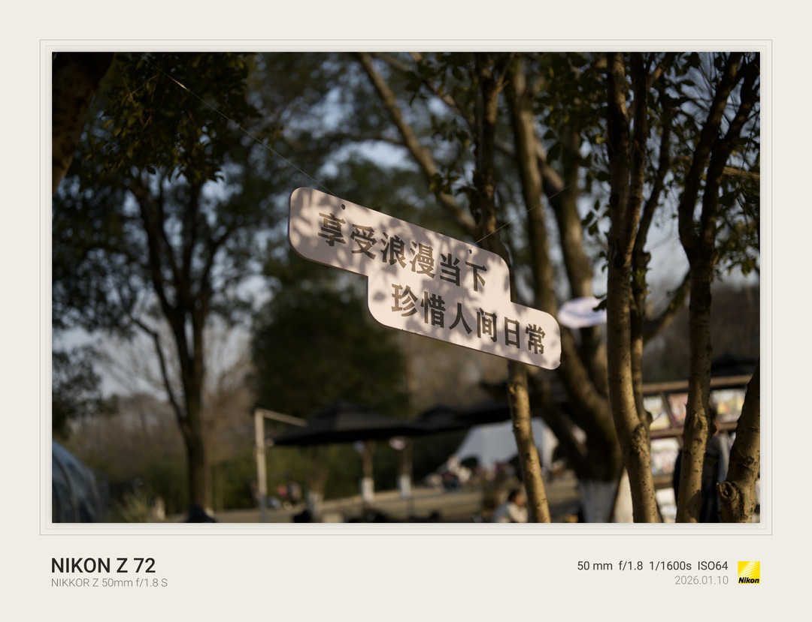 |

| [35mm胶片暗房印记](config/templates/35mm胶片暗房印记.json) | [主色提取色卡栏](config/templates/主色提取色卡栏.json) | [红标铭牌强调风](config/templates/红标铭牌强调风.json) | [极简双行分割线](config/templates/极简双行分割线.json) |
| --- | --- | --- | --- |
| 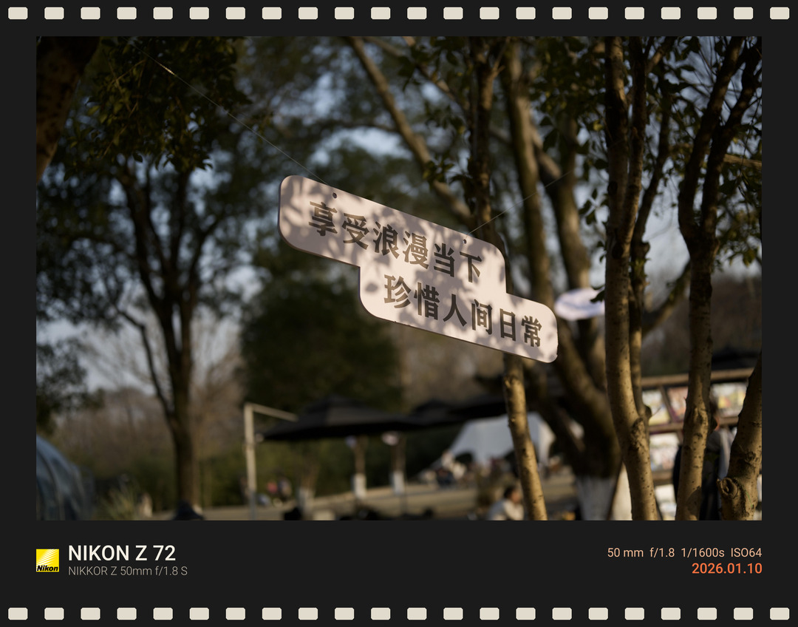 | 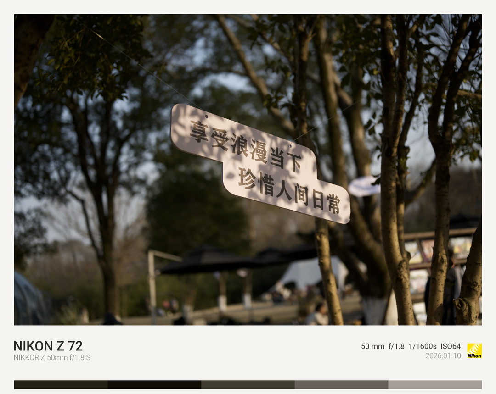 | 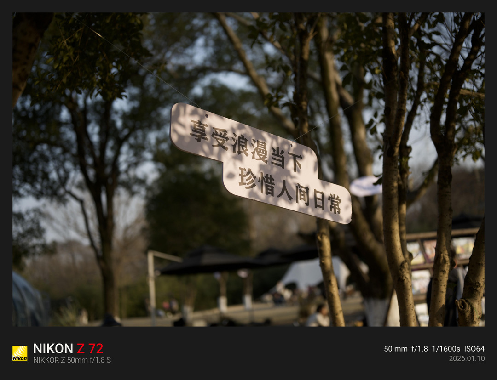 | 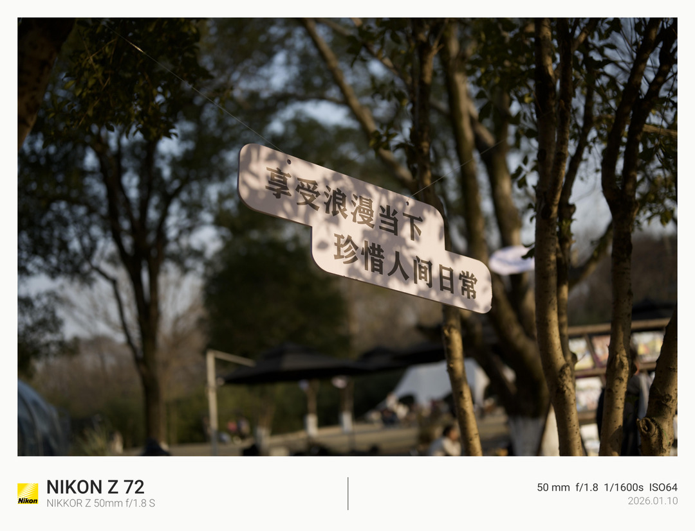 |

| 模板 | 说明 | 效果 |
| --- | --- | --- |
| [经典相机边框](static/standard1.json) | 相机、镜头和拍摄参数 |  |
| [留白与阴影](static/standard2.json) | 圆角照片、阴影和宽边框 | 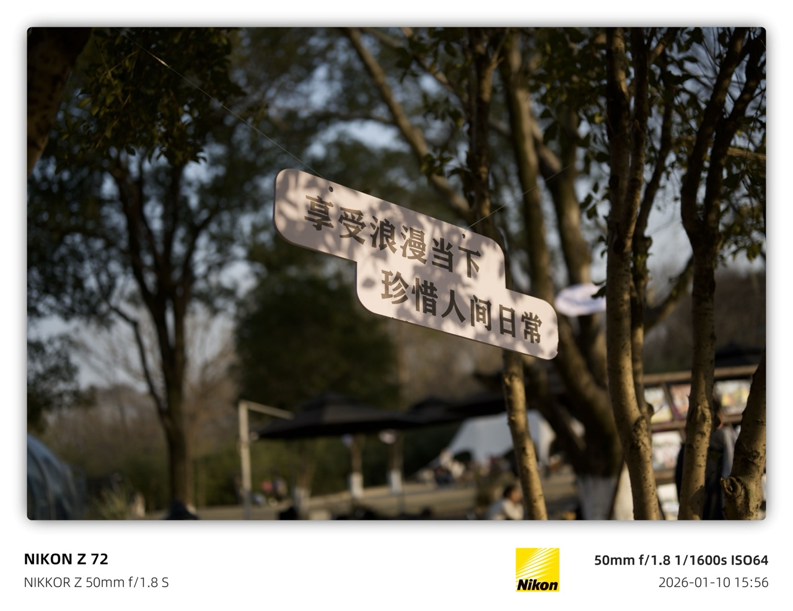 |
| [沉浸模糊背景](static/blur.json) | 延展画面色彩，居中显示拍摄信息 | 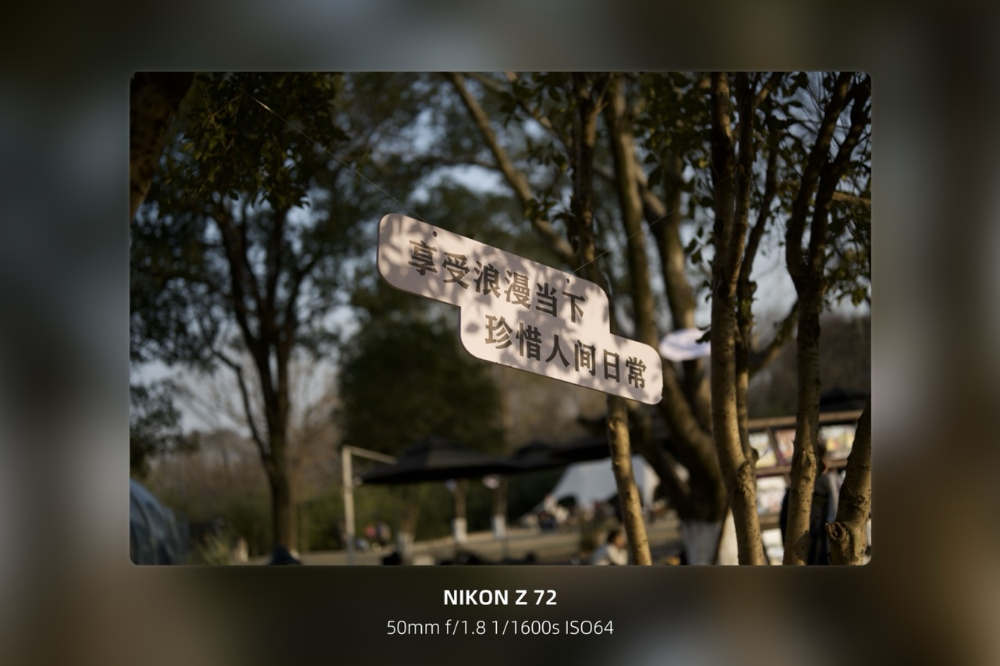 |
| [尼康模糊背景](static/nikon_blur.json) | 适合尼康照片的专属版式 |  |
| [极简参数](static/normal1.json) | 在右下角显示拍摄参数 | 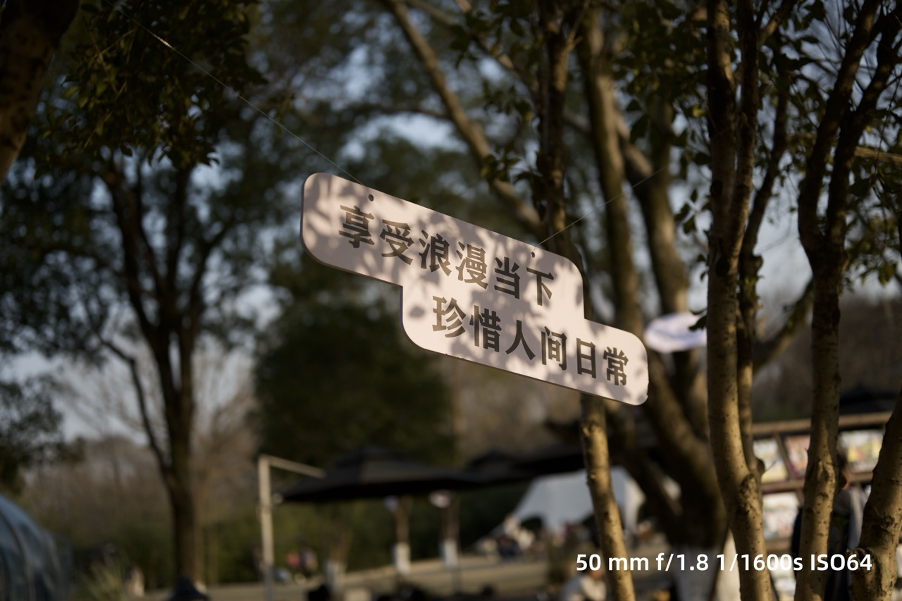 |
| [旅途与时间](static/normal2.json) | 文件夹名称和拍摄时间 |  |
| [品牌居中](static/center_logo.json) | 标识居中，两侧可自由组合文字 | 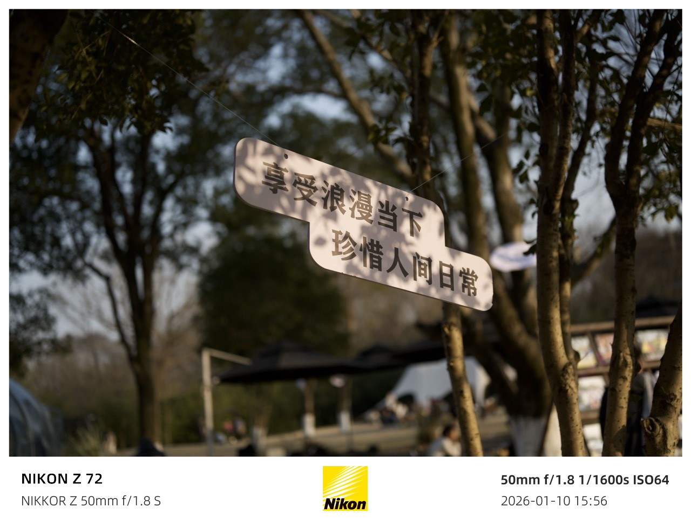 |
| [仅品牌标识](static/center_logo_only.json) | 在底部居中显示品牌标识 |  |

## 作者与项目引用

ExifFrame 作者：[Leo-John233](https://github.com/Leo-John233)

| 项目 | 作者 | 与 ExifFrame 的关系 |
| --- | --- | --- |
| [semi-utils](https://github.com/leslievan/semi-utils) | leslievan | 开发基础，提供原始水印处理流程和示例素材 |
| [ExifEditor-GUI](https://github.com/Leo-John233/ExifEditor-GUI) | Leo-John233 | 照片信息编辑与迁移功能的参考，本项目使用独立的 Qt 实现 |
| [ExifTool](https://exiftool.org/) | Phil Harvey | 照片元数据的读取、写入和迁移工具 |

本项目采用 [Apache License 2.0](LICENSE)，相关项目与工具保留各自许可条款，ExifTool 许可见[官方网站](https://exiftool.org/#license)，开发资料见[功能对照与历史性能记录](docs/compatibility-and-performance.md)和[示例照片生成脚本](scripts/build_preview_sample.py)
